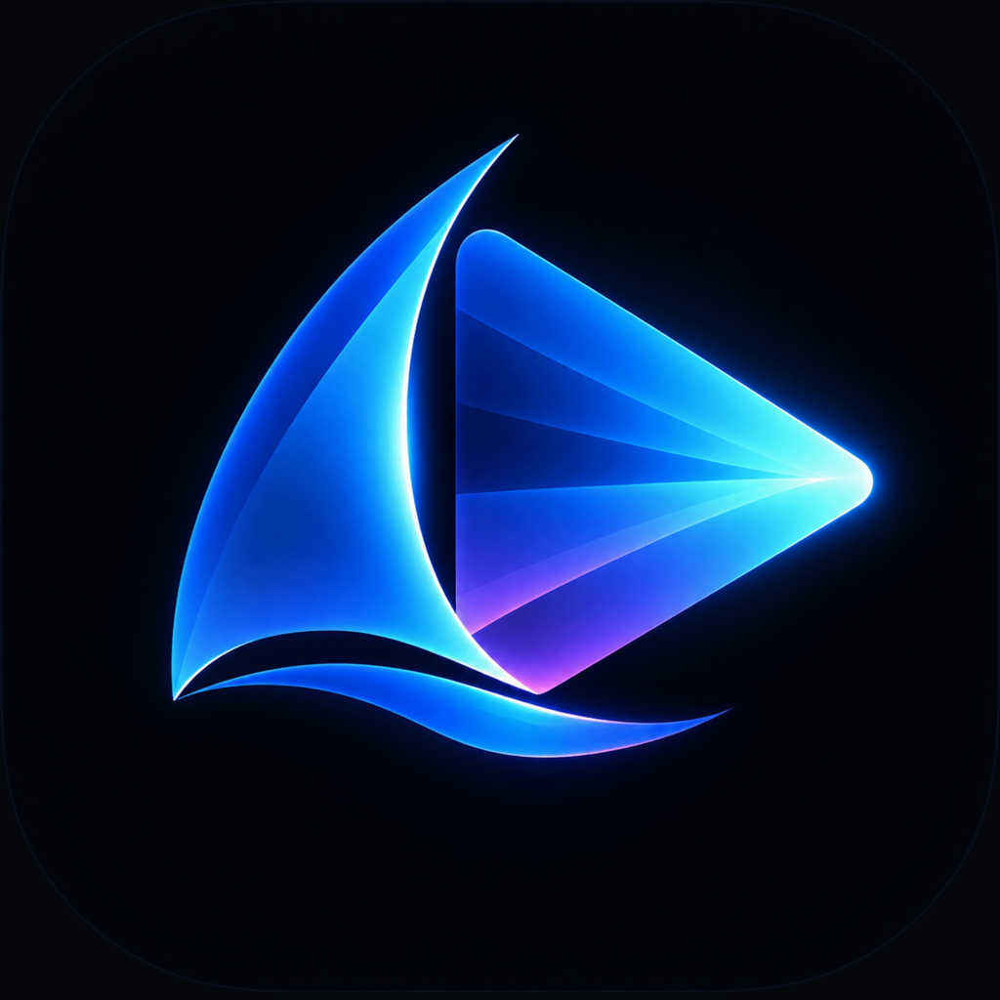

<p align="center">
  
</p>

<h1 align="center">Vela for iOS / iPadOS / macOS</h1>

<p align="center">
  面向 <strong>Jellyfin</strong> 与 <strong>Emby</strong> 的 Apple 原生客户端，Swift 6 + SwiftUI，适配 iOS / iPadOS / macOS 27 与 Liquid Glass。
</p>

Android 版见 [ZeroDevi1/Vela](https://github.com/ZeroDevi1/Vela)（基于 [JellyCine](https://github.com/sureshfizzy/JellyCine)）。本仓库按 Android 版的功能与约定在 Apple 平台上原生实现，不共享代码。

> 当前状态：开发中（M0 框架完成，M1 播放完善与详情页改版进行中）。进度与排期见 [docs/ROADMAP.md](docs/ROADMAP.md)。

---

## 功能

### 服务器

- 同时支持 Jellyfin 与 Emby；添加时自动补全 `https` / `http` 与 Emby 的 `/emby` 路径，并识别服务器类型
- 多服务器切换；每台服务器可设备注、多条线路（局域网 / 公网）、STRM 原始地址直连
- **私密服务器**：每次启动后需面容 ID / 触控 ID / 密码解锁，解锁状态只在内存中保存；进入多任务切换器时遮挡内容；未解锁时不参与聚合搜索
- 访问 token 保存在 Keychain（仅本机），服务器列表 JSON 不含敏感信息

### 浏览

- 首页：继续观看、下一集、最新入库
- 媒体库：分页网格，按最近添加 / 名称 / 上映日期 / 评分排序
- **聚合搜索**：同时搜索所有已登录服务器，限制并发，单个服务器失败只在其分区提示
- **详情页**：沉浸式头图与 Logo、评分 / 分级 / 类型 / 连载状态、继续播放与进度、已看 / 收藏；剧集的季与按 50 集分段的单集列表；播放源（版本 / 音轨 / 字幕）预选；章节缩略图、演职人员、类似作品、外部链接；视频 / 音频 / 字幕流的完整媒体信息

### 播放

- 系统内核 AVPlayer：HDR10 / 杜比视界（Profile 5、8.x）/ HLG 原生输出，空间音频、画中画、AirPlay
- 按设备实测能力（AV1 / HEVC 硬解、HDR）生成 DeviceProfile：能直放就直放；MKV 等由服务器转封装为 HLS fMP4，视频流复制不损画质
- 字幕：文本字幕（内嵌 / 外挂、SRT / ASS 等）由服务器转 WebVTT 后本地渲染，可调字号、位置与延迟；图形字幕可选服务器烧录
- 音轨切换、跳过片头 / 回顾（Jellyfin 媒体片段、Emby 章节标记，可自动跳过）、下一集倒计时自动播放
- 播放进度与已看状态同步到服务器；锁屏 / 控制中心正在播放与远程控制
- **手势**（iPhone / iPad）：单击显隐控制层；左 / 右侧双击快退 / 快进、中间双击暂停；横滑调进度；左侧竖滑亮度、右侧竖滑音量；长按临时倍速；捏合切换适应 / 填充；锁定
- **macOS**：独立播放器窗口，空格 / ← → / F / Esc 快捷键，双击全屏

### 平台

| 平台 | 目标设备 | 说明 |
|---|---|---|
| iOS 27 | iPhone 16 Pro | 底部 Liquid Glass 标签栏，下滑自动收起 |
| iPadOS 27 | iPad Pro 11"（2022） | 可展开侧边栏，支持多窗口 |
| macOS 27 | MacBook Air 13"（M4） | 原生 SwiftUI（非 Catalyst），系统「设置」窗口（⌘,） |

---

## 构建

需要 Xcode 27（iOS / macOS 27 SDK）。

1. 打开 `Vela.xcodeproj`，选择 `Vela` scheme
2. 目标选择 iPhone / iPad 模拟器或 My Mac 运行
3. 真机运行前在 Signing & Capabilities 中选择开发团队（仓库未配置 `DEVELOPMENT_TEAM`）

命令行：

```bash
xcodebuild -project Vela.xcodeproj -scheme Vela -destination 'platform=iOS Simulator,name=iPhone 17 Pro' build
```

```bash
xcodebuild -project Vela.xcodeproj -scheme Vela -destination 'platform=macOS' build
```

包单元测试（Swift Testing）：

```bash
cd Packages/VelaKit && swift test
```

若 `xcode-select` 指向 CommandLineTools，可在命令前加 `DEVELOPER_DIR=/Applications/Xcode-beta.app/Contents/Developer`。

---

## 目录结构

```
Vela.xcodeproj          多平台 App target（同步文件夹，新增文件无需改工程）
Vela/                   App 入口（Scene / 窗口 / 设置）与资源
Config/Vela-Info.plist  后台音频、ATS 等
Packages/VelaKit/       全部业务代码（本地 Swift 包）
  VelaCore              领域模型、线路路由、日志
  VelaNetwork           Jellyfin / Emby 客户端、DTO、DeviceProfile
  VelaData              服务器存储、登录、聚合搜索、隐私、选流、播放上报
  VelaPlayer            播放内核协议、AVPlayer 内核、控制器、手势、字幕、VR、正在播放
  VelaDesignSystem      主题与通用卡片组件
  VelaFeatures          各页面与 AppModel
docs/                   架构与路线图
```

依赖方向：`Features → Data / Player / DesignSystem → Network → Core`。详见 [docs/ARCHITECTURE.md](docs/ARCHITECTURE.md)。

## 文档

- [docs/ARCHITECTURE.md](docs/ARCHITECTURE.md)：Android 版特征映射、模块与关键设计、播放内核选型
- [docs/ROADMAP.md](docs/ROADMAP.md)：里程碑、已完成项、已知问题与后续排期

## 隐私

Vela 只与你添加的媒体服务器通信，不收集任何数据。账号 token 保存在本机 Keychain。

## 许可证

[GNU General Public License v3.0](LICENSE)，与 Vela / JellyCine 保持一致。
